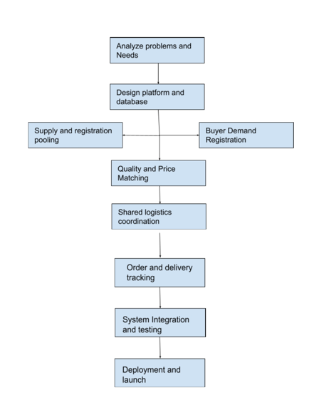

# Smart India Hackathon Workshop
# Date: 25/11/2026
## Reference Number: 26011027
## Name: S Kamalika

## Problem Title
SIH 26033: Multiple intermediaries reduce farmers earnings and increase consumer prices.

## Problem Creater's Organization
Ministry of Consumer Affairs, Food & Public Distribution

## Theme
Agriculture, FoodTech & Rural Development

## Problem Description
Expected Solution: Create a digital marketplace that:

• Connects farmers/FPOs directly with consumers and bulk buyers.
• Provides logistics support.
• Uses AI for demand forecasting and route optimization.

Benefits:

• Better prices for farmers.
• Lower prices for consumers.
• Reduced supply chain inefficiencies.

## Proposed Solution

A digital platform that connects farmers, Farmer Producer Organisations (FPOs), buyers, and transporters to manage the entire agricultural supply chain in one place. Instead of just acting as an online marketplace, it coordinates crop supply, buyer demand, and delivery. 

The problems it addresses:

Small, scattered harvests: Pools crops from many farmers through FPOs and matches them directly to active buyer orders, giving farmers stronger bargaining power and buyers larger, market-ready batches.

Lack of price & quality clarity: Shares live market (mandi) prices, buyer offers, and crop quality grades so farmers make smarter selling decisions and face fewer rejected deliveries.
High transport costs & delays: Combines nearby pickups and deliveries into shared trips to lower shipping costs and reduce food spoilage.

Disconnected middlemen & hidden fees: Connects all existing players on one system and tracks every price and expense for smoother coordination and full transparency.

What makes it unique:

Demand-First Aggregation: Identifies what crops, quality, and quantity buyers need before gathering produce from farmers, preventing unsold surplus.

Shared Logistics: Groups compatible pickups and drop-offs to maximize truck space and cut transport costs.

All-in-One Coordination: Combines live market prices, quality grades, and cost tracking without cutting out useful middlemen
helping farmers, traders, and transporters work together efficiently.

## Technical Approach

Flow of the app:

## Feasibility and Viability

Why the app works:

Can be built affordably using standard tools like Python, web frameworks, databases, digital maps, and route-planning software.

A modular setup allows launching small in one local area first, then expanding gradually by partnering with FPOs and mandis.

Some challenges we could face and their solutions:

some farmers lack smartphones, internet, or digital skills.
Solution: Build a simple, local-language app and use FPOs to help onboard farmers.

Wrong crop, price, or quality details can cause bad matches.
Solution: Verify crop details and pull live prices from trusted mandi sources.

Syncing multiple farms, trucks, and schedules is tough.
Solution: Use route-optimization software to plan shared pickups and deliveries.

Users may hesitate to adopt a brand-new platform.
Solution: Keep all pricing, records, and delivery tracking completely transparent.

Sudden market shifts can disrupt deals.
Solution: Start small with one crop in a limited area, test what works, and scale up slowly.

## Impact and Benefits

Farmers: Better market access, stronger bargaining power, and higher net income.

FPOs: Easier collection of crops from farmers and direct access to large buyers.

Buyers & Retailers: Reliable supply of crops in the exact quality and quantity needed.

Transporters: Fuller trucks and more organized, steady delivery jobs.

Consumers: Fresher produce at fairer prices due to lower supply-chain costs.

Impacts:

Empowers small farmers through better market access, encourages teamwork via FPOs, builds trust through transparency, and promotes rural digital adoption.

Boosts farmer profits by cutting middleman and transport costs, connects farmers to bulk buyers, and supports smarter pricing.

Reduces empty truck trips, lowers fuel use and emissions, cuts down food spoilage with timely pickups, and uses farm resources more efficiently.

## Research and References
1. enam.gov.in
2. agmarknet.gov.in
3. "Collaborative Vehicle Routing Problem (CVRP) in agricultural supply chains" - A research paper which first states the importantance of vehical routing in the cost of the goods we buy.

